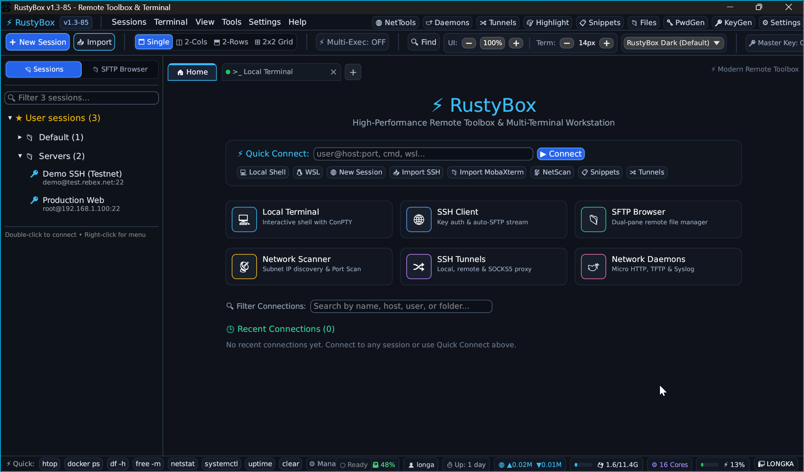

# ⚡ RustyBox - Cross-Platform Remote Terminal & SSH Toolbox (Pure Rust)

[](https://www.rust-lang.org/)
[](LICENSE)
[]()
[]()
[](https://github.com/longanhvn/rustybox)

> **RustyBox** là bộ công cụ Remote Terminal, SSH Client & SFTP Toolbox đa nền tảng hiện đại, hiệu năng cực cao, viết 100% bằng **Rust** (sử dụng framework đồ họa `egui`/`eframe`). 
> Ứng dụng hoạt động hoàn toàn độc lập (**Portable**), khởi động tức thì, dung lượng siêu nhẹ (~10 MB sau khi strip), không phụ thuộc runtime cồng kềnh, được thiết kế làm giải pháp thay thế mạnh mẽ, bảo mật và hiện đại cho MobaXterm, Termius và PuTTY.



---

## 📦 Tải về dùng ngay (Pre-built Portable Binaries)

Người dùng tải về là chạy trực tiếp được ngay (**Zero Install / Portable 100%**, không cần cài đặt dependencies hay runtime phụ):

| Hệ điều hành | Tệp thực thi Portable | Dung lượng | Hướng dẫn sử dụng |
| :--- | :--- | :--- | :--- |
| **🪟 Windows 10 / 11 (x64)** | [**`RustyBox-windows-x64.exe`**](https://github.com/longanhvn/rustybox/releases/download/v1.4.3/RustyBox-windows-x64.exe) | ~20 MB | Tải về nhấp đúp chạy ngay |
| **🐧 Linux (Ubuntu / Debian / Fedora)** | [**`RustyBox-linux-x64`**](https://github.com/longanhvn/rustybox/releases/download/v1.4.3/RustyBox-linux-x64) | ~18 MB | `chmod +x RustyBox-linux-x64 && ./RustyBox-linux-x64` |
| **🍎 macOS Universal (Apple Silicon & Intel)** | [**`RustyBox-macos-universal`**](https://github.com/longanhvn/rustybox/releases/download/v1.4.3/RustyBox-macos-universal) | ~33 MB | `chmod +x RustyBox-macos-universal && ./RustyBox-macos-universal` |
| **🍎 macOS Apple Silicon (M1/M2/M3/M4)** | [**`RustyBox-macos-arm64`**](https://github.com/longanhvn/rustybox/releases/download/v1.4.3/RustyBox-macos-arm64) | ~17 MB | `chmod +x RustyBox-macos-arm64 && ./RustyBox-macos-arm64` |

*👉 Xem danh sách toàn bộ các bản phát hành tại: [**GitHub Releases**](https://github.com/longanhvn/rustybox/releases)*

---

## 📸 Điểm nổi bật & Tính năng chính

### 1. 🖥️ Multi-Terminal & Đa bố cục (Split Views & 20+ Tabs Management)
- **Quản lý dải Tab mượt mà khi mở 10–20+ Tab:**
  - Thanh tab hỗ trợ **cuộn ngang linh hoạt (`ScrollArea::horizontal`)**, tự động cuộn đến tab đang hoạt động (`auto-scroll into view`).
  - **Menu chuyển tab nhanh (`📑 N ▾` Tab Switcher):** Nút dropdown thông minh hiển thị danh sách toàn bộ tab đang mở kèm icon phân loại (Local, SSH, WSL, Telnet), cho phép chuyển tab hoặc đóng tab đơn lẻ tức thì.
  - Tự động chuyển sidebar bên trái sang tab **Sessions** ngay khi mở bất kỳ tab mới nào.
- **Bố cục chia màn hình tức thì (Layout Switcher):**
  - `Single`: Chế độ xem 1 màn hình chuẩn.
  - `2-Cols (Horizontal)`: Chia đôi trái/phải xem đồng thời 2 máy chủ.
  - `2-Rows (Vertical)`: Chia đôi trên/dưới.
  - `2x2 Grid`: Chia 4 góc xem đồng thời 4 máy chủ cùng lúc.
- **Bộ giả lập VT100 / Xterm hoàn chỉnh:** Hỗ trợ đầy đủ bảng màu 256 ANSI, 24-bit TrueColor, con trỏ mượt mà, đầy đủ các tổ hợp phím tắt chuẩn terminal (`Ctrl+C`, `Ctrl+D`, `Ctrl+Z`, `Ctrl+L`...).
- **Khởi động không chớp đen (Zero-Flicker):** Tối ưu hóa native viewport `with_transparent(false)` và cơ chế `Lazy Spawning` Local Terminal, loại bỏ hoàn toàn hiện tượng nháy đen màn hình khi mở ứng dụng trên Windows.

### 2. ⚡ Multi-Execution (Phát lệnh đồng thời)
- Công tắc **`⚡ Multi-Exec`** tích hợp trực tiếp trên thanh công cụ chính.
- Khi bật, mọi câu lệnh bạn gõ trên tab hiện tại sẽ được **tự động phát thanh (broadcast) đến toàn bộ các tab server đang mở cùng lúc** mà không bị nghẽn hay trễ tín hiệu, hỗ trợ bảo trì hàng loạt máy chủ trong tích tắc.

### 3. 🛡️ An toàn dòng lệnh (Multi-line Paste Safety Confirmation)
- Hộp thoại cảnh báo an toàn tự động xuất hiện khi dán đoạn văn bản có chứa nhiều dòng hoặc ký tự xuống dòng (`\n`).
- Cho phép xem trước chính xác nội dung câu lệnh trước khi thực thi để ngăn ngừa việc vô tình chạy nhầm lệnh phá hủy hệ thống.

### 4. 🎨 Themes & Tùy biến Font Terminal
- **6 Bảng màu Terminal chuyên nghiệp:** *RustyBox Dark*, *Dracula*, *Solarized Dark*, *Monokai*, *Nord*, và *Hacker Matrix*.
- **Hỗ trợ phông chữ lập trình đa dạng:** Cascadia Code, JetBrains Mono, Fira Code, Consolas, Courier New, MesloLGS NF, DejaVu Sans Mono kèm thanh trượt cỡ chữ và độ mờ nền (Background Opacity).

### 5. 📁 High-Speed Graphical SFTP Browser & Built-in Editor
- **Truyền tải tệp siêu tốc:** Bộ đệm đọc/ghi tối ưu hóa 512 KB kèm socket buffer 2 MB giúp đạt tốc độ truyền tải tối đa trên đường truyền mạng.
- **Trình duyệt tệp đồ họa tiện ích:** Tải lên (`Upload`), Tải về (`Download`), Tạo thư mục, Xóa tệp, Đổi tên, và thanh Breadcrumbs điều hướng nhanh.
- **Trình soạn thảo mã nguồn nâng cao (Built-in Code Editor):**
  - Cửa sổ co giãn tự do (`resizable`), tự động điều chỉnh theo kích thước màn hình.
  - **Công tắc bật/tắt bẻ dòng (`↩ Wrap: ON / OFF`):** Chống tràn chiều ngang khi mở các tệp có dòng siêu dài (JSON nén, minified log, base64).
  - Cột đánh số dòng (Line Numbers Gutter) chuẩn xác, phông Monospace rõ nét, thanh cuộn hai chiều (`ScrollArea::both`).
  - Thanh công cụ tích hợp lưu phím tắt `Ctrl+S`, tìm kiếm từ khóa `Ctrl+F` (đếm số match theo thời gian thực), tăng/giảm cỡ chữ và thanh trạng thái hiển thị số dòng, dung lượng tệp.

### 6. 📜 Ghi log phiên tự động xoay vòng (5-Day Auto-Rotating Logs)
- Tự động ghi lại toàn bộ nội dung xuất ra terminal theo từng phiên làm việc vào thư mục `./data/logs/`.
- Cơ chế xoay vòng tự động duy trì log trong vòng **5 ngày gần nhất** và tự dọn dẹp các tệp log cũ hơn, đảm bảo không làm đầy ổ cứng.
- Nút bấm truy cập nhanh thư mục log trực tiếp từ giao diện.

### 7. ⌨️ Quick Macros & Sysadmin Toolbar
- Thanh công cụ phím tắt lệnh nhanh (Sysadmin Toolbar) tích hợp các lệnh phổ biến: `htop`, `docker ps`, `df -h`, `free -m`, `netstat`, `systemctl status`...
- **Macro Manager:** Cho phép người dùng tự do tạo, chỉnh sửa, lưu trữ và kích hoạt các đoạn kịch bản / lệnh shell thường dùng chỉ với 1 click.

### 8. 🔐 Bảo mật Master Password Vault (Argon2id + AES-256-GCM)
- **Chuẩn mã hóa chứng thực quân sự (AEAD):**
  - **Argon2id:** Dẫn xuất khóa 256-bit an toàn với Salt ngẫu nhiên 16 bytes sinh từ phần cứng, chống tấn công brute-force/GPU.
  - **AES-256-GCM:** Mã hóa toàn bộ mật khẩu phiên và danh bạ thông tin xác thực (`Credential Store`) với Nonce 12 bytes ngẫu nhiên độc lập cho từng trường dữ liệu.
- **Không rò rỉ dữ liệu:** Toàn bộ mật khẩu trên đĩa lưu dưới dạng `enc:v1:<nonce>:<ciphertext>`.
- **Cơ chế Khóa theo nhu cầu (On-Demand Lazy Lock):** Mở app an toàn, không làm phiền người dùng khi chỉ dùng local terminal. Khi kết nối SSH, app giải mã an toàn trong bộ nhớ RAM và inject vào PTY mà không sinh file tạm ra đĩa.

### 9. 🗄️ Lưu trữ Portable & Tự phục hồi dữ liệu (Self-Healing)
- **Kiến trúc Portable 100%:** Toàn bộ cấu hình và danh bạ lưu trữ gọn gàng tại thư mục `./data/RustyBox.json` ngay cạnh file thực thi. Không ghi file rác vào registry hay AppData hệ thống.
- **Cơ chế sao lưu xoay vòng (Rolling Backups):** Tự động tạo bản sao lưu snapshot (`RustyBox.json.<unixtime>`) trước mỗi lần ghi đĩa và duy trì tối đa **3 bản sao lưu mới nhất**.
- **Tự động khôi phục khi lỗi (Self-Healing):** Nếu file JSON chính bị lỗi hỏng đột ngột do mất nguồn, RustyBox tự động phát hiện và phục hồi từ bản backup hợp lệ gần nhất.

### 10. 🛠️ Tiện ích & Dịch vụ mạng tích hợp
- **Network Scanner (NetScan):** Quét IP dải mạng nội bộ (Subnet Discovery), kiểm tra cổng dịch vụ bất đồng bộ (Async TCP Port Scan) kèm đo độ trễ mạng ms.
- **SSH Tunnels Manager:** Quản lý trực quan Local Port Forwarding, Remote Forwarding và SOCKS5 Dynamic Proxy với công tắc kích hoạt tức thì.
- **Embedded Network Daemons:** Tích hợp sẵn Micro HTTP File Server, TFTP Server và Syslog Server phục vụ cứu hộ thiết bị mạng và truyền file nhanh.
- **SSH Key Generator:** Tạo cặp khóa SSH chuẩn OpenSSH (Ed25519, RSA 2048/4096-bit) kèm comment và fingerprint.
- **Password Generator:** Sinh mật khẩu ngẫu nhiên độ an toàn cao với các tùy chọn ký tự hoa, thường, số, ký tự đặc biệt.
- **Text Diff Tool:** So sánh trực quan sự khác biệt giữa hai văn bản hoặc hai file cấu hình.

---

## 🏗️ Kiến trúc mã nguồn (Project Architecture)

```text
rust-remote-toolbox/
├── Cargo.toml                  # Cấu hình dependencies (eframe, portable-pty, vt100, argon2, aes-gcm, chrono...)
├── src/
│   ├── main.rs                 # Điểm khởi chạy ứng dụng, thiết lập native window qua eframe
│   ├── lib.rs                  # Module declarations phục vụ unit testing
│   ├── app.rs                  # Bộ điều khiển chính (RustyBoxApp), giao diện UI, layout, tabs, modals, clock
│   ├── session/
│   │   ├── mod.rs              # Kiểu dữ liệu Session, SessionType, Credential
│   │   ├── storage.rs          # Quản lý lưu trữ Portable, sao lưu xoay vòng 3 bản, mã hóa Argon2id + AES-256-GCM
│   │   ├── ui.rs               # Giao diện cây danh bạ Sessions, dialogs, menu chuột phải
│   │   └── import_export.rs    # Parser import cấu hình MobaXterm (.txt, .ini) và JSON
│   ├── terminal/
│   │   ├── pty_session.rs      # Quản lý tiến trình terminal PTY (ConPTY Windows & POSIX PTY Linux/macOS)
│   │   ├── vt_screen.rs        # Bộ phân tích chuỗi thoát VT100/ANSI, render 256 màu, TrueColor
│   │   ├── themes.rs           # Quản lý các bộ bảng màu terminal (Dracula, Nord, Matrix, Solarized...)
│   │   └── fonts.rs            # Quản lý phông chữ terminal tùy chỉnh
│   ├── sftp/
│   │   ├── mod.rs              # Cấu trúc dữ liệu, buffer truyền tải 512KB, trạng thái editor
│   │   └── ui.rs               # Giao diện SFTP Explorer đồ họa và Advanced Built-in Code Editor
│   ├── network_tools/
│   │   └── mod.rs              # Tokio async Port Scanner, Ping, Subnet Discovery
│   ├── tunneling/
│   │   └── mod.rs              # Trình quản lý SSH Tunnels (Local, Remote, SOCKS5)
│   ├── macros/
│   │   └── mod.rs              # Quản lý kịch bản lệnh nhanh Quick Macros & Sysadmin Toolbar
│   └── daemons/
│       └── mod.rs              # Micro HTTP File Server, TFTP Server và Syslog Server
├── data/
│   ├── RustyBox.json           # File lưu trữ dữ liệu phiên và mật khẩu mã hóa ở chế độ Portable
│   └── logs/                   # Thư mục lưu log terminal tự động xoay vòng 5 ngày
└── tests/                      # Bộ kiểm thử tự động (Unit & Integration tests)
```

---

## 🚀 Hướng dẫn biên dịch & Chạy ứng dụng

### Yêu cầu môi trường
* **Rust:** Phiên bản ổn định mới nhất (Rust 1.85+ hoặc ấn bản Edition 2024).
* Cài đặt qua rustup: `curl --proto '=https' --tlsv1.2 -sSf https://sh.rustup.rs | sh`

### 1. Chạy trên Linux / macOS
```bash
git clone https://github.com/longanhvn/rustybox.git
cd rustybox

# Chạy trực tiếp ở chế độ phát triển
cargo run

# Biên dịch bản phát hành tối ưu
cargo build --release
```

### 2. Biên dịch chéo cho Windows (Cross-compilation từ WSL/Linux)
```bash
# Cài đặt target Windows GNU
rustup target add x86_64-pc-windows-gnu

# Biên dịch release
cargo build --release --target x86_64-pc-windows-gnu

# Cắt giảm symbol tối ưu dung lượng (strip binary)
x86_64-w64-mingw32-strip target/x86_64-pc-windows-gnu/release/rust-remote-toolbox.exe -o RustyBox.exe
```

### 3. Chạy kiểm thử tự động (Test Suite)
Dự án có bộ test tự động kiểm tra chặt chẽ luồng mã hóa đĩa, cơ chế xoay vòng backup, terminal PTY và các module mạng:
```bash
cargo test --bin rust-remote-toolbox -- --test-threads=4
```
*Kết quả yêu cầu: 160/160 unit tests passed.*

---

## 🔗 Liên kết & Thông tin dự án

* **GitHub Repository:** [https://github.com/longanhvn/rustybox](https://github.com/longanhvn/rustybox)
* **Tác giả:** Long kakaka (longanhvn)
* **Giấy phép mã nguồn (License):** Dự án được phát hành theo giấy phép mã nguồn mở [MIT License](LICENSE). Hoàn toàn tự do sử dụng, chỉnh sửa và phân phối.
