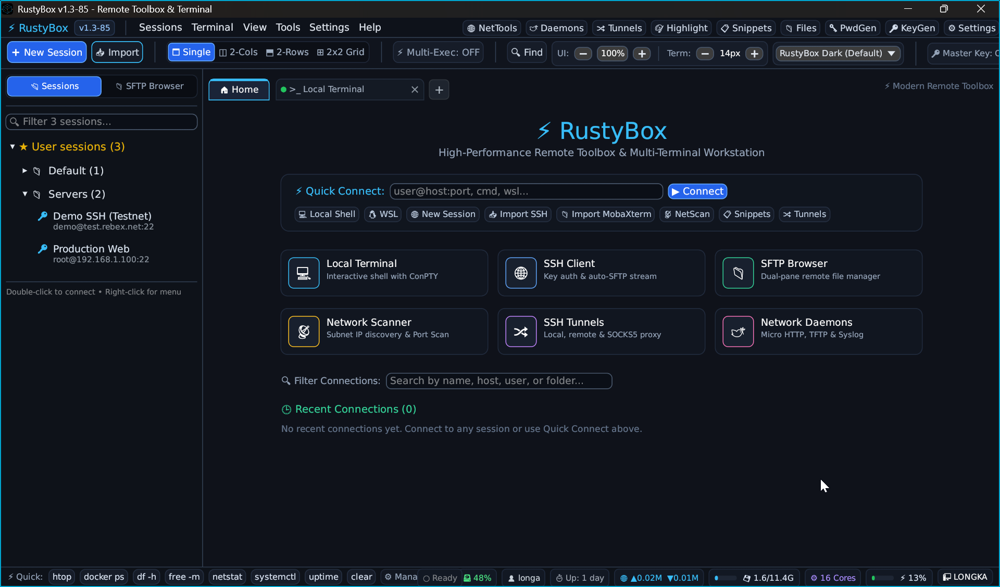

# ⚡ RustyBox - Cross-Platform Remote Terminal Toolbox (Pure Rust)

[](https://www.rust-lang.org/)
[](LICENSE)
[]()
[]()

> **RustyBox** là bộ công cụ Remote Terminal & SSH Toolbox đa nền tảng hiện đại, hiệu năng cao, viết 100% bằng **Rust**. Ứng dụng hoạt động độc lập (Portable), khởi động tức thì, dung lượng siêu nhẹ (~12 MB), không phụ thuộc runtime cồng kềnh, được thiết kế làm giải pháp thay thế mạnh mẽ cho MobaXterm, Termius và PuTTY.



---

## 📸 Điểm nổi bật & Tính năng chính

### 1. 🖥️ Multi-Terminal & Đa bố cục (Split Views)
- **Quản lý đa tab mượt mà:** Khởi tạo không giới hạn các phiên Local Terminal (PowerShell, CMD, Bash, WSL) và phiên SSH từ xa.
- **Bố cục chia màn hình tức thì (Layout Switcher):**
  - `Single`: Chế độ xem 1 màn hình chuẩn.
  - `2-Cols (Horizontal)`: Chia đôi trái/phải xem đồng thời 2 máy chủ.
  - `2-Rows (Vertical)`: Chia đôi trên/dưới.
  - `2x2 Grid`: Chia 4 góc xem đồng thời 4 máy chủ cùng lúc.
- **Bộ giả lập VT100 / Xterm hoàn chỉnh:** Hỗ trợ đầy đủ bảng màu 256 ANSI, 24-bit TrueColor, con trỏ mượt mà, đầy đủ các tổ hợp phím tắt chuẩn terminal (`Ctrl+C`, `Ctrl+D`, `Ctrl+Z`, `Ctrl+L`...).

### 2. ⚡ Multi-Execution (Phát lệnh đồng thời)
- Nút gạt **`⚡ Multi-Exec`** tích hợp trực tiếp trên thanh công cụ chính.
- Khi bật, mọi câu lệnh bạn gõ trên tab hiện tại sẽ được **tự động phát thanh (broadcast) đến toàn bộ các tab server đang mở cùng lúc** mà không bị nghẽn hay trễ tín hiệu, hỗ trợ bảo trì hàng loạt máy chủ trong tích tắc.

### 3. 🎨 Giao diện Sleek Modern Dark UI
- **Thiết kế công nghệ cao:** Tone màu Slate/Zinc sâu lắng (`#0A0E17`, `#10141D`), độ tương phản chuẩn nét (`#F0F6FC`), viền mảnh phản quang (`#222A3A`) và bo góc mềm mại 6px–8px.
- **Home Welcome Dashboard:** Trang chào đón trung tâm với khối Quick Connect và hệ thống **6 Action Cards (lưới 3x2)** tích hợp icon badge màu chuyên biệt (*Local Terminal, SSH Client, SFTP Browser, NetScan, Tunnels, Daemons*).
- **Thanh Telemetry đáy:** Hiển thị trực quan trạng thái hệ thống theo thời gian thực (*Host, User, CPU load, CPU cores, RAM gauge, Net I/O, Uptime*) cùng dàn phím tắt Quick commands (*htop, docker ps, df -h, free -m, netstat, systemctl, ...*).

### 4. 📁 Dual-Pane Graphical SFTP Browser & Editor
- **Tự động bám theo Session:** Khi mở kết nối SSH, sidebar bên trái chuyển đổi linh hoạt sang trình duyệt tệp đồ họa SFTP.
- **Thao tác tệp trực quan:** Tải lên (`Upload`), Tải về (`Download`), Tạo thư mục, Xóa tệp, Đổi tên, và thanh Breadcrumbs điều hướng nhanh.
- **Trình soạn thảo nhanh tích hợp:** Xem và chỉnh sửa trực tiếp các tệp cấu hình trên server từ xa với tính năng lưu (`Save`) tức thời mà không cần cài thêm công cụ phụ.

### 5. 🔐 Bảo mật Master Password Vault (Argon2id + AES-256-GCM)
- **Chuẩn mã hóa chứng thực quân sự (AEAD):**
  - **Argon2id:** Dẫn xuất khóa 256-bit an toàn với Salt ngẫu nhiên 16 bytes sinh từ phần cứng, chống tấn công brute-force/GPU.
  - **AES-256-GCM:** Mã hóa toàn bộ mật khẩu phiên và danh bạ thông tin xác thực (`Credential Store`) với Nonce 12 bytes ngẫu nhiên độc lập cho từng trường dữ liệu.
- **Không rò rỉ dữ liệu:** Toàn bộ mật khẩu trên đĩa lưu dưới dạng `enc:v1:<nonce>:<ciphertext>`.
- **Cơ chế Khóa theo nhu cầu (On-Demand Lazy Lock):** Mở app an toàn, không làm phiền người dùng khi chỉ dùng local terminal. Khi kết nối SSH, app giải mã an toàn trong bộ nhớ RAM và inject vào PTY mà không sinh file tạm ra đĩa.

### 6. 🗄️ Lưu trữ Portable & Tự phục hồi dữ liệu (Self-Healing)
- **Kiến trúc Portable 100%:** Toàn bộ cấu hình và danh bạ lưu trữ gọn gàng tại thư mục `./data/RustyBox.json` ngay cạnh file thực thi. Không ghi file rác vào registry hay AppData hệ thống.
- **Cơ chế sao lưu xoay vòng (Rolling Backups):** Tự động tạo bản sao lưu snapshot (`RustyBox.json.<unixtime>`) trước mỗi lần ghi đĩa và duy trì tối đa **3 bản sao lưu mới nhất**.
- **Tự động khôi phục khi lỗi (Self-Healing):** Nếu file JSON chính bị lỗi hỏng đột ngột do mất nguồn, RustyBox tự động phát hiện và phục hồi từ bản backup hợp lệ gần nhất.

### 7. 🛠️ Tiện ích & Công cụ mạng tích hợp
- **Network Scanner:** Quét IP dải mạng nội bộ (Subnet Discovery), kiểm tra cổng dịch vụ bất đồng bộ (Async TCP Port Scan) kèm đo độ trễ mạng ms.
- **SSH Tunnels Manager:** Quản lý trực quan Local Port Forwarding, Remote Forwarding và SOCKS5 Dynamic Proxy với công tắc kích hoạt tức thì.
- **Embedded Network Daemons:** Tích hợp sẵn Micro HTTP File Server, TFTP Server và Syslog Server phục vụ cứu hộ thiết bị mạng và truyền file nhanh.
- **SSH Key Generator:** Tạo cặp khóa SSH chuẩn OpenSSH (Ed25519, RSA 2048/4096-bit) kèm comment và fingerprint.
- **Password Generator:** Sinh mật khẩu ngẫu nhiên độ an toàn cao với các tùy chọn ký tự hoa, thường, số, ký tự đặc biệt.
- **Text Diff Tool:** So sánh trực quan sự khác biệt giữa hai văn bản hoặc hai file cấu hình.

---

## 🏗️ Kiến trúc mã nguồn (Project Architecture)

```text
rust-remote-toolbox/
├── Cargo.toml                  # Khai báo dependencies (eframe, portable-pty, vt100, argon2, aes-gcm...)
├── src/
│   ├── main.rs                 # Điểm khởi chạy ứng dụng, thiết lập native window qua eframe
│   ├── lib.rs                  # Module declarations phục vụ unit testing
│   ├── app.rs                  # Bộ điều khiển chính (RustyBoxApp), giao diện UI, layout, tabs, modals
│   ├── session/
│   │   ├── mod.rs              # Kiểu dữ liệu Session, SessionType, Credential
│   │   ├── storage.rs          # Quản lý lưu trữ Portable, sao lưu xoay vòng 3 bản, mã hóa Argon2id + AES-256-GCM
│   │   ├── ui.rs               # Giao diện cây danh bạ Sessions, dialogs, menu chuột phải
│   │   └── import_export.rs    # Parser import cấu hình MobaXterm (.txt, .ini) và JSON
│   ├── terminal/
│   │   ├── pty_session.rs      # Quản lý tiến trình terminal PTY (ConPTY Windows & POSIX PTY Linux/macOS)
│   │   └── vt_screen.rs        # Bộ phân tích chuỗi thoát VT100/ANSI, render 256 màu, TrueColor
│   ├── sftp/
│   │   ├── mod.rs              # Cấu trúc dữ liệu và logic kết nối duyệt tệp SFTP
│   │   └── ui.rs               # Giao diện SFTP Explorer đồ họa và trình soạn thảo văn bản
│   ├── network_tools/
│   │   └── mod.rs              # Tokio async Port Scanner, Ping, Subnet Discovery
│   └── tunneling/
│       └── mod.rs              # Trình quản lý SSH Tunnels (Local, Remote, SOCKS5)
├── data/
│   └── RustyBox.json           # File lưu trữ dữ liệu phiên và mật khẩu mã hóa ở chế độ Portable
└── tests/                      # Bộ kiểm thử tự động (Unit & Integration tests)
```

---

## 🚀 Hướng dẫn biên dịch & Chạy ứng dụng

### Yêu cầu môi trường
* **Rust:** Phiên bản ổn định mới nhất (Rust 1.85+ hoặc ấn bản Edition 2024).
* Cài đặt qua rustup: `curl --proto '=https' --tlsv1.2 -sSf https://sh.rustup.rs | sh`

### 1. Chạy trên Linux / macOS
```bash
git clone https://github.com/longkaka/rust-remote-toolbox.git
cd rust-remote-toolbox

# Chạy trực tiếp ở chế độ phát triển
cargo run

# Biên dịch bản phát hành tối ưu
cargo build --release
```

### 2. Biên dịch chéo cho Windows (Cross-compilation từ WSL/Linux)
```bash
# Cài đặt target Windows GNU
rustup target add x86_64-pc-windows-gnu

# Biên dịch release
cargo build --release --target x86_64-pc-windows-gnu

# Cắt giảm symbol tối ưu dung lượng (strip binary)
x86_64-w64-mingw32-strip target/x86_64-pc-windows-gnu/release/rust-remote-toolbox.exe -o RustyBox.exe
```

### 3. Chạy kiểm thử tự động (Test Suite)
Dự án có bộ test tự động kiểm tra chặt chẽ luồng mã hóa đĩa, cơ chế xoay vòng backup và phát hiện prompt SSH:
```bash
cargo test
```
*Kết quả yêu cầu: 9/9 tests passed.*

---

## 📜 Giấy phép mã nguồn (License)
Dự án được phát hành theo giấy phép mã nguồn mở [MIT License](LICENSE). Hoàn toàn tự do sử dụng, chỉnh sửa và phân phối.
